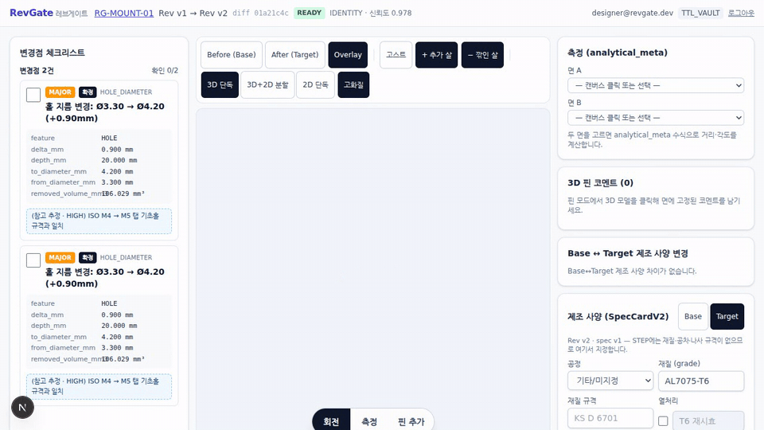
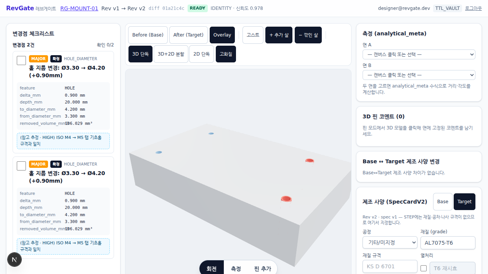
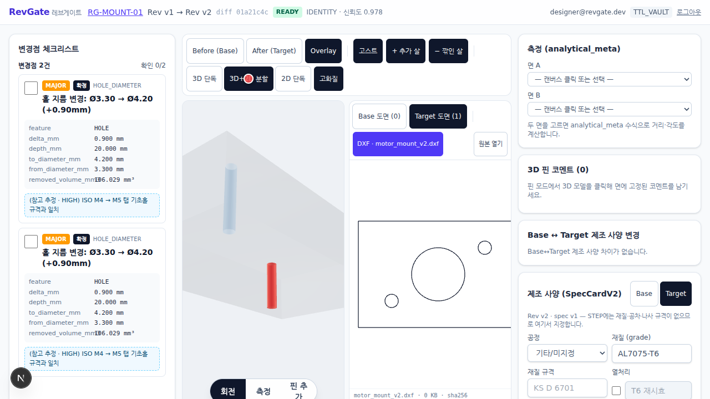

# RevGate (레브게이트)

링크 하나로 3D 형상(STEP) 변경점, 제조 사양(`SpecCardV2`), 2D 도면(PDF/DXF)을 정밀 대조·검토하고, SHA-256 봉인 **가공 착수 승인 증빙 PDF**까지 발급하는 제조·가공 외주 발주용 리비전 게이트입니다.

- **전체 사용 매뉴얼:** [docs/USER_MANUAL.md](docs/USER_MANUAL.md) (발주처 설계자 · 가공업체 현장 작업자 · 접수함 · 관리자 가이드 & FAQ/에러 코드 사전)
- **제품 및 아키텍처 문서:** [docs/PRODUCT_SPEC.md](docs/PRODUCT_SPEC.md) · [docs/IMPLEMENTATION_BLUEPRINT.md](docs/IMPLEMENTATION_BLUEPRINT.md) · [docs/PHASE4_MANUFACTURING_SPEC.md](docs/PHASE4_MANUFACTURING_SPEC.md) · [docs/REVGATE_GUIDE.md](docs/REVGATE_GUIDE.md)

<div align="center">



<table>
  <tr>
    <td align="center" width="50%">
      <br/>
      <sub><b>B-Rep 3D 형상 Diff · 홀 치수/제거 체적 자동 판정</b></sub>
    </td>
    <td align="center" width="50%">
      <br/>
      <sub><b>3D+2D(DXF/PDF) 분할 뷰 · 고스트 오버레이 · SpecCardV2</b></sub>
    </td>
  </tr>
</table>

</div>

---

## 핵심 기능 (Phase 1 – 4)

### 1. OpenCASCADE B-Rep 3D Diff 엔진 (`workers/cad`)
- **STEP(ISO 10303-21) 파싱 및 검증:** 인치(`INCH`) → 밀리미터(`MM`) 자동 변환, `ShapeFix_Shape` 복구(`HEALING_APPLIED`), 헬리컬 나사산 폭탄 감지(`HELICAL_THREADS_DETECTED`), 솔리드(`≤ 10개`)·면(`≤ 15,000면`) 가드.
- **자동 정합 + 3-2-1 수동 정합:** Stage 0~2 자동 정합 신뢰도 미달(`ALIGN_CONFIDENCE_MIN = 0.50`) 시 `NEEDS_ALIGN` 상태로 전환하고, 웹 UI에서 `3-2-1 Datum Align`으로 강체 `4×4` 변환 행렬을 즉시 적용(`q-diff-interactive`).
- **보수적 기하 분류 & 폴백:** 추가 살/깎인 살(`delta_added.glb`, `delta_removed.glb`), 홀/보스, 평면 오프셋, 박육 경고(`< 1.00 mm` CRITICAL / `< 2.00 mm` & 30% 이상 감소 MAJOR) 산출. B-Rep 불리언 15초 초과 시 5,000점 샘플 히트맵(`BOOLEAN_FALLBACK_HEATMAP`)으로 자동 폴백.
- **격리 워커 실행:** `1-Job-1-Subprocess`(60초 타임아웃, `mem_limit: 2g` swap 없음) 및 Brotli 압축 `lod0.glb` / `lod1.glb` / `analytical_meta.json` 생성.

### 2. 제조 신뢰 백엔드 & 불변 승인 증빙 (`apps/api`)
- **제조 사양 (`SpecCardV2` & `SpecDiff`):** 공정(`CNC_MILLING`, `CNC_TURNING`, `PRINT_FDM`, `PRINT_SLA_SLS_MJF`, `SHEET_METAL`, `OTHER`), 재질, 열처리, 표면처리(아노다이징 두께·색상·거칠기 Ra·마스킹), 일반/중요 공차, 나사·인서트, 적층 사양, 주문/검사 수준 편집 및 `CRITICAL` / `MAJOR` / `INFO` 차이 자동 비교.
- **4대 사양 경고:** `MISSING_MATERIAL`, `MISSING_TOLERANCE`(승인 전 필수 확인), `UNDECLARED_THREAD`, `MISSING_BUILD_ORIENTATION`.
- **2D 도면·사양서 첨부:** `2D_PDF`(`.pdf`), `2D_DXF`(`.dxf`), `SPEC_SHEET`(`.pdf/.xlsx/.xls/.csv/.txt/.docx/.doc`) 최대 25 MiB, SHA-256 검증 업로드.
- **구버전 자동 무효화 (`SUPERSEDED`) & PDF 봉인:** 승인 완료 후 새 리비전(`NEW_REVISION`), 사양 수정(`SPEC_UPDATED`), 도면 추가·삭제(`DRAWING_UPDATED`) 발생 시 기존 승인 링크를 즉시 `SUPERSEDED` 처리하고 원본 다운로드를 차단. 승인 시 `Snapshot SHA-256`과 함께 **WeasyPrint 가공 착수 승인 증빙 PDF** 생성.
- **보안·감사:** 매직 링크(`rg_sid`, 7일), 외부 6자리 OTP(`rg_ext_sid`, 24시간, 5분 유효/5회 잠금/10분당 3회 제한), `TTL_VAULT`(30~90일) vs `ZERO_RETENTION`(SHA-256 검증 `RedropPanel` 재드롭), append-only `audit_events` 테이블.

### 3. Next.js 15 + Three.js 통합 리뷰 웹 (`apps/web`)
- **`/login` · `/workspace`:** 매직 링크 로그인(로컬 개발 시 `DEV · rg:dev:outbox`), 부품 등록, 단일/페어(Base+Target 자동 Diff) STEP 드롭존(`≤ 50 MiB`), 1,500ms 폴링 & SSE 실시간 진행 표시, `OWNER` 전용 보안 정책 설정.
- **`/parts/[partId]/diffs/[diffId]`:** PC 3컬럼 `[3D 단독 | 3D+2D 분할 | 2D 단독]` & 태블릿(`<1024px`) `[3D 뷰 | 2D 도면 (N)]` + `BottomSheet`, `Before`/`After`/`Overlay`/`고스트`/`+ 추가 살`/`− 깎인 살` 전환, `회전`/`측정`/`핀 추가`, `DatumAlignPanel`, `SpecEditor`, `AttachmentManager`, `ShareLinkPanel`, 12분 주기 Signed URL 자동 갱신.
- **`/r/[token]`:** 로그인 없는 외부 가공업체 게이트(`OtpGate`), `Watermark` + 포커스 이탈 블러, `sessionStorage` 오프라인 동기화 큐(`OfflineQueue`), 공정별 `DfmChecklist`, 상단 적색 `SUPERSEDED` 배너.
- **`/shop/[slug]`:** 로그인 없는 외부 거래처용 v1/v2 STEP 비교 접수함 (`SLUG` URL 발급 & 자동 분석).

---

## 저장소 구조

```text
revgate/
├── apps/
│   ├── api/                  # FastAPI + SQLAlchemy 2.0(asyncpg) + Alembic + ARQ + WeasyPrint PDF
│   └── web/                  # Next.js 15 + React 19 + Three.js + PDF.js/DXF 뷰어 + Vitest/Playwright
├── workers/cad/              # OpenCASCADE(OCP) B-Rep 엔진 + ARQ 워커 (q-ingest, q-diff-*, q-purge)
├── packages/contracts/       # SSOT JSON Schema -> TypeScript + Pydantic v2 (codegen & 검증)
├── infra/                    # docker-compose (Postgres 16, Redis 7, MinIO, api, cad-worker, api-tests)
├── scripts/                  # validate-glb.mjs (Khronos glTF-Validator)
├── docs/                     # 설계 스펙 및 전체 사용 매뉴얼 (USER_MANUAL.md)
├── Makefile
└── pnpm-workspace.yaml
```

---

## 빠른 시작 (로컬 개발 환경)

### 1. Docker 백엔드·인프라 기동

`make`가 있는 Linux/WSL 환경:

```sh
make dev        # Postgres :5432, Redis :6379, MinIO :9000/:9001 + 3 buckets + CORS
make stack      # + FastAPI :8000 (Alembic migration 포함) + cad-worker (ARQ 4 queues)
```

`make` 없이 Docker Compose 직접 실행:

```sh
docker compose -f infra/docker-compose.yml --profile app up -d
```

### 2. 웹 프론트엔드 실행 (`http://localhost:3000`)

```sh
corepack pnpm install
corepack pnpm --filter @revgate/contracts run codegen
corepack pnpm --filter @revgate/web dev
```

- 브라우저에서 `http://localhost:3000/login`으로 이동해 업무용 이메일(예: `designer@revgate.local`)을 입력하면, 로컬 개발 모드(`dev_outbox=true`)에서는 화면 하단의 **`DEV · rg:dev:outbox`** 박스에서 매직 링크 및 외부 `/r/[token]`의 6자리 OTP(`dev-otp`)를 바로 확인할 수 있습니다.
- 세부 사용 방법은 [docs/USER_MANUAL.md](docs/USER_MANUAL.md)를 참고하세요.

---

## 계약 검증 및 테스트 실행

```sh
# 1. SSOT JSON Schema / TypeScript / Pydantic 계약 검증
corepack pnpm --filter @revgate/contracts run check

# 2. CAD 엔진 및 Golden STEP 테스트 (Docker linux/amd64, 실제 OpenCASCADE)
docker compose -f infra/docker-compose.yml --profile cad run --rm --no-deps cad-worker pytest -q

# 3. API 통합 테스트 (실제 Postgres + Redis + MinIO + cad-worker 연동)
docker compose -f infra/docker-compose.yml --profile test run --rm api-tests pytest -q

# 4. 웹 타입체크 · 린트 · 단위 테스트 · 프로덕션 빌드 · Playwright E2E
corepack pnpm --filter @revgate/web typecheck
corepack pnpm --filter @revgate/web lint
corepack pnpm --filter @revgate/web test
corepack pnpm --filter @revgate/web build
corepack pnpm --filter @revgate/web e2e
```

---

## 주요 제한 및 로컬 인프라 참고

- **업로드·CAD 한도:** STEP(`.step`, `.stp`) 최대 **50 MiB**, 2D 첨부파일(`2D_PDF`, `2D_DXF`, `SPEC_SHEET`) 최대 **25 MiB**, 단일 STEP 솔리드 **10개 이하**, 면 수 **15,000면 이하**, CAD 서브프로세스 타임아웃 **60초**(불리언 **15초** 초과 시 히트맵 폴백).
- **오브젝트 스토리지:** 로컬 MinIO 기본값은 호환 커뮤니티 빌드(`pgsty/minio`, `pgsty/mc`)를 사용하며, `.env.example`을 참고해 환경 변수를 재정의할 수 있습니다.
- **이메일·SMS:** 별도 외부 메일/SMS 프로바이더 대신 로컬에서는 Redis 리스트 `rg:dev:outbox`(`GET /v1/dev/outbox`, `REVGATE_ENV=prod` 또는 `DEV_OUTBOX=false` 시 비활성화)로 동작합니다.
