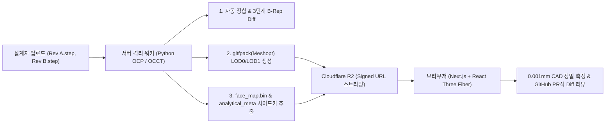

# RevGate (레브게이트) — 웹서비스 기획서

> **한 줄 정의:** 카톡 캡처에 빨간 줄 긋는 도면 소통을 끝내고, 링크 하나로 3D 형상 변경점을 정밀 대조·합의·승인하는 **하드웨어 외주 발주용 GitHub PR & 도면 접수 게이트**

---

## 1. 기획 배경 및 문제 정의

### 현장의 Pain Point
- **소통 파편화와 오가공 사고:** 중소 제조사 기구설계자와 정밀 가공업체 사이에서 `부품_최종_v4.step` 같은 파일이 카톡·이메일로 오가고, "여기 홀 지름 0.5mm 키웠어요"를 캡처 이미지 위 빨간 펜으로 설명하다가 구버전 가공·오가공·납기 지연·수백만 원대 소재 폐기 사고가 반복된다.
- **기존 툴의 공백:** 엔터프라이즈 PLM(Teamcenter 등)은 수천만 원대 비용과 무거운 도입 장벽 때문에 영세·중소 임가공 현장에서 쓸 수 없고, 단순 무료 웹 3D 뷰어는 메쉬 테셀레이션 오차 때문에 치수 측정과 리비전 Diff가 불가능하다.
- **브라우저 3D 생태계 성숙:** WebGL2/WebGPU 기반 경량 렌더링과 서버사이드 OpenCASCADE(OCCT) 파이프라인을 결합하면, 별도 CAD 프로그램 설치 없이 공장 PC·태블릿 브라우저에서 즉시 동작하는 정밀 Diff 협업 워크플로우 구축이 가능하다.

### 초기 타겟 (MVP Wedge)
- **핵심 타겟:** 단품(Single Part) ~ 초소형 서브어셈블리(10개 파트 이하)의 **CNC 절삭가공 및 산업용 3D프린팅 외주 발주처**(로봇/드론/장비 스타트업 기구설계자) ↔ **정밀 임가공 업체**
- **선정 이유:**
  1. CNC 알루미늄/SUS 단품 STEP(1~30MB)은 평면·원통(홀/보스)·포켓·필렛 위주라 B-Rep Face 매칭 정확도를 초반부터 극대화할 수 있다.
  2. 소량 다품종 시제품 발주는 리비전 변경이 며칠 단위로 발생하며, 오가공 1회 손실(수십~수백만 원 및 1~2주 지연)이 구독료 대비 압도적으로 커서 지불 의향이 높다.

### MVP에서 과감히 제외할 것 (Not-to-Do)
- ❌ **2D PDF 도면 자동 OCR/공차 비교:** 리비전별 참고 첨부파일로 나란히 열어보는 수준만 제공.
- ❌ **대형 어셈블리 BOM 비교 / 간섭 체크:** v2 이후 확장 영역.
- ❌ **브라우저 내 직접 CAD 모델링/수정:** 편집기가 아닌 **리뷰·비교·승인 게이트**에 집중.
- ❌ **가공업체 견적 중개 마켓플레이스:** 기존 거래처 간 소통 파이프라인 장악에 집중.

---

## 2. 네이밍 및 브랜드 포지셔닝

- **최종 선정:** **RevGate (레브게이트)**
- **탈락 후보 비교:**
  - `StepCheck`: 직관적이고 입에 붙지만 `.step` 확장자에 갇혀 향후 2D PDF·IGES·Parasolid 및 공장 접수함 확장 시 브랜드 폭이 좁아짐.
  - `DatumDiff`: 기술 정체성은 강하지만 B2B 결제·승인 워크플로우 색채가 약함.
- **RevGate 선정 이유:** *"생산 현장 투입 전 반드시 통과하는 리비전 검증·승인 관문(Gate)"*과 *"가공업체 전용 도면 접수 게이트(`revgate.io/shop/OO정밀`)"*를 동시에 포괄하며, 팀 플랜 과금 명분(단순 뷰어 ₩0 vs 오가공 방지 승인 게이트)이 가장 강하다.

---

## 3. 핵심 기술 아키텍처

### 3.1. 서버-클라이언트 연산 경계 분리
클라이언트 WASM(`opencascade.js`)은 32비트 메모리 한계(모바일/태블릿 ~1GB OOM)와 수십 MB 번들 크기 때문에 현장 저사양 PC/태블릿에서 치명적이다. **무거운 B-Rep 연산은 서버 격리 워커에서 1회 수행하고, 클라이언트는 초경량 렌더링과 해석적(Analytical) 정밀 조회만 담당**한다.

- **사이드카 기반 0.001mm 정밀 측정:** 서버가 B-Rep을 버리기 전 삼각형 인덱스↔원본 B-Rep Face ID 매핑(`face_map.bin`)과 각 면의 수학적 정의(`analytical_meta.msgpack`: 원통 중심축·반지름, 평면 방정식 등)를 추출한다. 클라이언트는 경량 메쉬만 60fps로 그리면서도, 두 홀을 클릭하면 메쉬 꼭짓점이 아닌 해석적 수식으로 0.001mm 수준의 중심거리·지름을 즉시 계산한다.

### 3.2. 좌표계 이동(Transform) 대응: 불변 특징 정합 + 3-2-1 Datum Align
설계자가 어셈블리 컨텍스트에서 Export해 원점이 밀리거나 회전한 경우, 단순 무게중심+PCA(비대칭 보스 추가 시 축 틀어짐)나 일반 ICP(부분 변경을 전체 평행이동으로 상쇄)는 거짓 Diff를 만든다.
1. **서버 자동 정합:** 불변 기하 특징(지배적 평면·원통 축 패턴·고유 면적 조합) 기반 정합 수행.
2. **예외 시 3-2-1 Datum Align UX:** 자동 정합 신뢰도가 낮거나 대칭형 부품이 뒤집힌 경우, 클라이언트가 가진 `analytical_meta`를 활용해 현장 치구 세팅과 동일한 **3-2-1 클릭 정합**(1차 기준 평면 → 2차 기준 홀/측면 → 3차 보조 홀/직교면)으로 브라우저에서 즉시 프리뷰 후 $T_{4\times 4}$ 행렬(16개 숫자)만 서버에 전달해 3~5초 내 재계산한다.

### 3.3. 3단계 B-Rep 공학적 Diff 파이프라인 & 팩트/추정 분리
표준 STEP(AP203/AP214)에는 CAD 피처 트리가 없으므로 B-Rep 껍데기만으로 거짓 없는 변경점을 추출한다.
1. **1단계 (Face-to-Face AAG 매칭):** 인접 면 그래프(AAG)와 기하 지문 해싱으로 불변 면을 소거한 뒤, 동일 축·평행 법선 면 쌍을 매칭해 `Ø3.30 → Ø4.20`, `포켓 깊이 +2.0mm` 등 **100% 기하학적 팩트**를 확정한다.
2. **2단계 (규칙 기반 AFR + 팩트/추정 분리):** 인접 면을 가공 피처로 묶고 ISO 규격표와 대조하되, UI에서는 반드시 Fact와 Reference를 분리 표기한다.
   - 예: `[확정] 홀 지름 변경: Ø3.30 → Ø4.20 (+0.90mm)` / `(참고 추정: ISO M4 → M5 탭 기초홀 규격과 일치)`
   - 마주 보는 평면 쌍 거리 변화로 최소 살두께 경고(`2.0mm → 1.2mm 박육 주의`) 제공.
3. **3단계 (자유곡면/필렛 Boolean & SDF 폴백):** 면 분할이 심한 B-Spline·필렛 구간은 OCCT Boolean(`B-A` 추가 살, `A-B` 깎인 살) 및 SDF 히트맵(15초 하드 타임아웃 초과 시 우아한 폴백)과 "육안 확인 필요(Uncertain Region)" 그룹핑으로 누락을 방지한다.

### 3.4. 워커 프로세스 격리 & 비동기 큐
손상된 STEP 파일은 C++ OCCT에서 파이썬 예외가 아닌 **Segfault**로 워커를 즉사시킬 수 있다. ARQ 태스크 내부에서 `subprocess.run(..., timeout=15)` 기반 **1-Job-1-Subprocess(컨테이너/cgroups 제한)** 격리를 강제하며, 4개 큐로 트래픽을 분리한다.
- `q-ingest`: 파싱, 테셀레이션, 사이드카 추출 (`tmpfs` 처리)
- `q-diff-batch`: 두 리비전 자동 정합 및 Diff 연산 (15초 타임아웃)
- `q-diff-interactive`: 유저 3-2-1 수동 정합 요청 최우선 처리 (3~5초 응답 목표)
- `q-purge`: Strict 모드 파기 및 TTL 만료 오브젝트 삭제 후 감사 로그(`RAW_PURGED`) 기록

---

## 4. 제조업 보안(NDA) 4중 방어 및 스토리지 구조

OCCT 서버 연산을 수행하면서 동시에 완전한 Zero-Knowledge E2EE를 주장하는 것은 기술적으로 모순이므로, 실제 현장의 유출 공포를 겨냥한 **정직한 2모드 + 4중 방어 아키텍처**를 채택한다.

1. **원본 미노출 (View-Only Proxy):** 외주처 브라우저에는 원본 STEP을 내려보내지 않고 양자화 메쉬(glTF)와 Diff 메타만 스트리밍한다. 원본 다운로드는 발주 승인 시 별도 토큰으로만 허용.
2. **워크스페이스 2가지 보관 모드 (Zero-Retention 모순 해결):**
   - **Mode A — 암호화 TTL 보관 (기본값):** 테넌트별 KMS 봉투 암호화로 일정 기간(30~90일) 보관해 `v1↔v3` 등 임의 조합 Diff 즉시 생성, 만료 시 자동 파기.
   - **Mode B — Strict Zero-Retention (방산/대기업 협력사용):** `tmpfs` 처리 직후 원본 STEP 즉시 영구 삭제(`raw_s3_key = NULL`). 추후 `v1↔v3` 비교 시에는 발주처 로컬의 `v1` 파일을 재드롭하면 SHA-256 해시 일치 검증 후 즉시 재연산(Hash-Verified Re-drop).
3. **회원가입 없는 6자리 OTP + 동적 워터마크:** 가공업체는 링크 클릭 → 휴대폰/이메일 6자리 OTP(10초)만으로 즉시 열람. 화면에 열람 업체·시각 동적 워터마크를 깔고, 변경점별 체크박스·3D 핀 코멘트·"가공 착수 승인" 이력을 WORM 버킷에 PDF 증빙 리포트로 보관해 분쟁을 예방한다.
4. **3단 버킷 Blast Radius 격리 (Cloudflare R2 / S3):**
   - `bucket-1-vault-raw-cad`: Private Only, CDN 연결 금지, KMS 암호화 및 Lifecycle TTL
   - `bucket-2-viewer-derived`: 15분 만료 Signed URL 스트리밍 (`lod0.glb`, `lod1.glb`, `face_map.bin`, `analytical_meta.msgpack`, `delta_added/removed.glb`)
   - `bucket-3-audit-proofs`: Object Lock(WORM) 기반 승인 증빙 PDF 보관

---

## 5. 수익화 모델 & Hub-and-Spoke PLG 전략

### 과금 원칙: "발주처가 내고, 가공업체는 영구 무료"
- 임가공 현장에 구독료를 요구하면 *"그냥 카톡으로 파일 보내주세요"* 한마디로 도입이 중단된다. 외부 리뷰어(가공업체)의 링크 열람, 3D 핀 코멘트, 가공 착수 승인은 **영구 무료·무제한**으로 고정한다.
- **유료 전환 트리거 (발주처 대상):**
  - Free (월 3건 비교/공유) → 시제품 발주 시즌에 1~2주 만에 한도 도달.
  - Pro / Team (예: 월 6만 ~ 25만 원대 구간): 무제한 리비전 Diff, 팀 워크스페이스, Strict Zero-Retention, 감사 증빙 PDF 자동 아카이빙. 오가공 1건 방어만으로 수개월 치 구독료 ROI 즉시 회수.

### 바이럴 루프: 가공업체 '역(逆) 전도사' Hub-and-Spoke 전략
발주처 1곳은 가공업체 2~5곳과 거래하지만, **가공업체 1곳은 발주처 30~100곳과 거래하는 슈퍼 허브(Hub)**다.
1. 발주처 A가 가공업체 X에 RevGate Diff 링크를 전송.
2. 가공업체 X가 카톡 설명 없이 1분 만에 변경점 확인·승인 완료.
3. 승인 완료 화면 하단에 **"다른 거래처 수정 도면도 카톡 말고 여기서 받아보세요 — 우리 공장 전용 무료 도면 접수함 만들기 (`revgate.io/shop/OO정밀`)"** CTA 노출.
4. 가공업체 X가 다른 발주처 B, C, D에게 *"수정 도면 여기로 올려주시면 변경점 자동 체크돼서 오가공 안 납니다"*라며 역으로 링크를 전파 → 발주처 B, C, D가 자연 유입 후 Pro/Team 유료 전환.

---

## 6. 4주 MVP 기술 스택, 로드맵 & 초기 GTM

### MVP 기술 스택
- **CAD / Diff 워커:** Python `OCP (cadquery-ocp)` + `subprocess` 1-Job 격리 + `gltfpack` (Meshopt 압축)
- **백엔드 / 큐 / DB:** `FastAPI` + `Redis` + `ARQ` + `PostgreSQL`
- **프론트엔드:** `Next.js` + `React Three Fiber (Three.js)`
- **스토리지:** `Cloudflare R2` (glTF 반복 스트리밍 Egress 무료)

### 주차별 금요일 데모 마일스톤
| 주차 | 핵심 목표 | 금요일 검증 기준 (Definition of Done) |
| :--- | :--- | :--- |
| **1주차** | **엔진** | CLI에 STEP 2개 입력 시 자동 정합 + 홀/평면 B-Rep Diff JSON + `lod.glb` + `face_map.bin` + `analytical_meta` 15초 내 생성 |
| **2주차** | **뷰어** | R3F 브라우저 뷰어에서 변경점 클릭 시 해당 면 줌인 및 두 홀 선택 시 0.001mm 정밀도 중심거리·지름 측정 동작 |
| **3주차** | **협업·보안** | 웹 업로드 → 격리 워커 → 공유 링크 발급 → 비로그인 6자리 OTP 열람 → 3D 핀 코멘트 및 "가공 착수 승인" 로그 저장 E2E 완료 |
| **4주차** | **파일럿 출시** | 3-2-1 수동 정합 예외 UX + 가공 스펙 변경 카드 + 승인 증빙 PDF + 카톡 OG 썸네일 카드 + 공장 전용 접수함 링크 실서버 배포 |

### 첫 활성 고객 10팀 확보 GTM: '5쌍(Pair) 동시 공략' 컨시어지 루프
1. 판교·성수·대전·대학 창업보육센터의 로봇/드론/하드웨어 스타트업 기구설계자 20명에게 콜드 DM/지인 소개로 접근:
   > *"이번 주 CNC 외주 보낼 수정 도면(v1→v2) 있으면 STEP 2개만 주세요. 10분 만에 3D 변경점 링크 만들어 드릴 테니 카톡에 파일 대신 붙여 보내고 사장님 반응만 알려주세요."*
2. 발주처 5곳이 링크를 보내면 거래처 CNC 가공업체 5곳이 자동으로 첫 열람자가 되며, 마케팅비 0원으로 **발주처 5 + 가공업체 5 = 10팀**을 동시에 확보하고 초기 실전 STEP 엣지케이스 20종까지 수집한다.
3. 가공업체가 승인 버튼을 누른 직후 직접 연락해 *"방금 보신 화면을 사장님 공장 전용 무료 도면 접수함으로 세팅해 드리겠다"*고 제안해 Hub-and-Spoke 루프를 점화한다.
